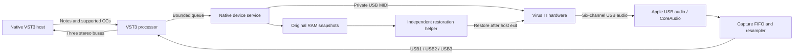

# Virus TI Rework

**Native Apple silicon VST3 integration for the Access Virus TI hardware synthesizer.**

An independent community project by **Give Me a Signal** to keep owned Virus TI hardware useful on modern Macs. The hardware makes the sound; this plug-in brings its MIDI control, USB audio returns, patch browsing and project recall into a native DAW.

**Status: private developer preview, preparing for an open-source release.** Working hardware playback and Bitwig project recall have been demonstrated on one TI Desktop. This is not yet a broadly tested, signed and notarized consumer release, nor a drop-in replacement for every Virus Control feature. New project code is MIT licensed. Original Access resources are supplied locally by the owner and are not included in this repository.


[Setup](#setup) · [What works](#what-works) · [How-it-works](#how-it-works) · [Engineering history](#how-we-built-it) · [Screenshots](#interface-gallery) · [Limitations](#known-limitations) · [Release packaging](#packaging-and-release-plan)

## What works

| Area | Implemented and tested scope |
| --- | --- |
| Native plug-in | arm64 VST3 processor/controller and Cocoa editor; three stereo output buses and sixteen-channel MIDI input |
| Real hardware audio | Capture through Apple's existing USB audio/CoreAudio support; six device channels mapped to USB1, USB2 and USB3 |
| Host sample rates | TI capture stays at 48 kHz; a 64-tap windowed-sinc resampler and FIFO drift correction adapt to the DAW |
| MIDI and parts | Private TI USB MIDI interface, note delivery, supported CC controls, sixteen-part selection and routing |
| Patch browser | 62 banks / 7,164 checksum-verified shipped patches after local resource import; search, categories, two panes and selected-part recall |
| Project recall | Versioned state contains sixteen RAM patches, RAM multi, routing and 2,672 mapped parameter values; connected projects reconnect when realtime processing starts |
| Recovery | Original RAM snapshots before changes; verified manual Disconnect; independent recovery helper after plug-in/DAW exit or host crash |
| Editor | Original-artwork renderer plus Modern Dark and Polar vector appearances, 100–200% scaling, dynamic graphs and host parameter gestures |
| Metering | Separate note-velocity activity and CC7 volume per part; three actual mixed USB capture peak meters |
| Local API | Per-user Unix socket and Python control tool; no network listener; hardware connection is explicit except restored connected projects |

The private MIDI path is reconstructed in user space. **We do not load the old Intel vendor plug-in, install the old kernel extension, or flash the synth.** Stored-bank writes and firmware commands are outside the hardware command allowlist.

## Setup

### Requirements

- Apple silicon Mac running macOS, an arm64 VST3 host and a powered Virus TI connected by USB.
- Your own **Virus TI Software Suite 5.1.7.00.pkg**. Setup supports the exact installer SHA-256 `3ebcfef395a6c5f1ef2162404228f1fbe571371f7389836f13c55c8a7636ce1d` and rejects other inputs.
- Apple Command Line Tools, CMake 3.25+, Ninja, Git and Python 3. Setup defaults to `/usr/bin/python3` from the Apple developer tools; `VTR_PYTHON` can select another working interpreter.
- Access to this private repository until it is made public.

The hardware build targets macOS 12 or later; that deployment target is **not** a compatibility certification. Current development/build checks ran on macOS 26.2, with physical testing on the project's TI Desktop. TI2, Snow, Intel Macs, Windows and other host/OS combinations are not validated releases.

### Build, validate and install

Install the developer prerequisites if needed (`xcode-select --install`; with an existing Homebrew installation, `brew install cmake ninja`). Then:

```sh
git clone https://github.com/Give-me-a-signal/virus-ti-rework.git
cd virus-ti-rework
bash setup.sh '/path/to/Virus TI Software Suite 5.1.7.00.pkg' --install
```

Setup expands the package **without running its installer**, reconstructs ignored local resources, fetches the pinned official VST3 SDK, builds arm64 code, runs six project test suites and the Steinberg validator, signs the local bundle ad hoc and verifies its nested helper signature. `--install` copies the result to:

```text
~/Library/Audio/Plug-Ins/VST3/Virus TI Rework Development.vst3
```

An existing plug-in is preserved under `~/Library/Application Support/VirusTIRework/PluginBackups/`. No administrator access or system-wide driver installation is needed. Fully quit and reopen the DAW so it loads the new binary. Omit `--install` to build and package without changing the installed plug-in.

The build output is `native/vst3/build-package/VST3/Release/Virus TI Rework Development.vst3`. A checksum-indexed **local-only** ZIP is written to `dist/`; it includes your imported Access resources and is not intended as a public MIT-only binary release. The current build has no Developer ID signature or notarization ticket.

### First hardware session

1. Start with the TI in Single mode and the desired sound selected. Load **Virus TI Rework (Development)** on a DAW instrument track. Keep your normal DAW audio output device.
2. Open the editor and press **Connect TI**. Connection snapshots the Single buffer, all sixteen part buffers and RAM multi, then configures temporary SEQ operation and three USB returns. Allow initialization to finish.
3. Send notes on MIDI channel 1 for Part 1. Parts 2–16 use channels 2–16. Route the plug-in's extra stereo outputs in your DAW when using USB2/USB3.
4. Browse and recall a patch into the selected part, or use supported controls. A local-only control is identified in hover information; not every displayed control currently sends hardware edits.
5. Save the DAW project with the device connected. A fresh hardware snapshot reads each part serially; keep controls unchanged during the save. On reopening, realtime processing triggers automatic connection and recall.
6. Use **Disconnect** for an explicit restore. Normal host exit also triggers the separate restoration helper. Keep the synth powered and connected until restoration completes—about 23 seconds in the measured exit tests.

Only one development instance may own the synth at a time. Plug-in scanning does not connect to hardware. Record or bounce **in real time**: offline export does not synthesize the external instrument.

To check recovery after the DAW closes:

```sh
/usr/bin/python3 tools/ti_control.py restorations
```

Snapshots and recovery logs live under `~/Library/Application Support/VirusTIRework/`. Restore covers documented sound/routing RAM data. Exit requests Single mode and normalizes USB configuration to two returns; it does not claim exact preservation of unknown global settings. Unplugging or replacing the USB device can prevent recovery.

## How it works



### Audio transport and driver work

Early work examined the original installer, kernel driver, shared libraries and MIDI driver to recover descriptors, packet layouts, initialization and clock behavior. We implemented bounded PCM conversion, asynchronous request lifecycles, descriptor parsing, rollback/drain behavior and clock-domain experiments as separate native modules.

The connected-device work established a simpler production route: reuse **Apple's existing USB audio transport**, then capture through CoreAudio from a native user-space service. Those earlier low-level transport modules remain useful research and test infrastructure; they are not a claim that a new kernel driver ships with this plug-in.

The production path uses a capture FIFO, 64-tap resampling and occupancy-based drift correction to bridge the TI's fixed 48 kHz stream to the host rate. The callback uses bounded queues and lock-free state; hardware operations, file access and snapshots happen on the worker. Missing audio is silenced. The reported buffering is approximately 42.7 ms, not a measured end-to-end latency figure.

Three-return operation required identifying the original **Global USB controller 9** configuration command. Hardware tests showed the third return was otherwise an input-like signal. Selecting the recovered three-return configuration fixed that path; teardown explicitly normalizes back to the standard two-return behavior.

### MIDI, state and recovery

Public MIDI discovery alone did not reproduce the original TI control path. Static analysis identified a separate private USB interface and protocol behavior. The new service opens that interface and sends a restricted set of note, supported CC, RAM-patch, request, routing and mode messages. MIDI reaches the hardware on the worker thread; sample offsets in the VST3 bridge do not imply sample-accurate USB scheduling.

Project state stores real hardware patches, rather than merely the positions of visible knobs. Every dump is bounded and checksum-checked. Bitwig testing exposed two practical defects: overly slow duplicate reads during Save, and host state caching after API-driven edits. Serial single reads and explicit controller dirty notifications resolved the tested save/reopen path.

DAW shutdown exposed another issue: a plug-in cannot rely on being allowed to spend approximately 23 seconds restoring hardware inside termination callbacks. A separate signed helper now retains the original snapshots and exclusive device lease before changes begin. A private pipe signals normal completion or host disappearance. The helper validates device identity, restores RAM, verifies readbacks and records the outcome even when the host exits abruptly.

### Editor reconstruction

The original XML supplied the 907×513 layout, control bindings, conditions and value lists. The original PNGs supplied the optional familiar appearance. REA/Ghidra analysis informed waveform display tables, graph geometry and envelope/filter behavior. A new native Cocoa view implements the interaction and VST3 bindings; it does not execute the old editor.

Dark and Polar draw modern vector controls using the same structural layout. Work included dynamic oscillator/filter/envelope graphics, popup semantics, patch-bank parsing, keyboard interaction and scaling. A UI sweep corrected PNG-DPI scaling that displaced oscillator controls, and menu resizing/text layout that stretched arrows or clipped values.

This is a documented reverse-engineering reconstruction, not recovered vendor source and not a clean-room claim. Graphs visualize editor parameters; they are not a software model of the TI's audio engine.

## How we built it

| Stage | Work and outcome |
| --- | --- |
| Inventory | Expanded the owner-supplied 5.1.7.00 package, hashed artifacts, catalogued architecture/framework dependencies and retained originals unchanged. |
| Static analysis | Used the REA skill/MCP and Ghidra to trace the legacy kernel, MIDI, common engine and editor paths; kept evidence IDs and decompilation snapshots locally. |
| Offline foundations | Built and tested descriptor, PCM, queue, MIDI, session and clock modules before relying on connected hardware. |
| Native VST3 | Added arm64 processor/controller, sixteen-part parameters, state validation, three stereo buses and a native editor; exercised the official validator. |
| UI and browser | Reconstructed the original layout, added graph interaction, verified 7,164 patches, corrected layout defects and added Dark/Polar appearances. |
| Real TI audio | Verified private-interface MIDI and USB audio, then integrated CoreAudio capture and resampling directly into the plug-in's service. |
| Multi-part validation | Auditioned all sixteen parts, verified sound/routing recall, repaired USB3 initialization and checked 44.1/48/96 kHz host rates. |
| DAW validation | Demonstrated playback in Live; verified native Bitwig project save/reopen, automatic reconnection and all sixteen hardware sounds. |
| Exit recovery | Reproduced the quit-time RAM restoration failure, implemented the independent helper, and tested graceful exit, abrupt termination and normal Bitwig quit. |
| Repository preparation | Separated owner-supplied resources, added reproducible local setup/packaging, MIT licensing, fresh UI gallery and source-only checks. |

Firmware/wavetable decoding and emulator experiments were a parallel research track. They helped offline investigation but are **not required to play the physical TI**, are not a firmware update feature, and the emulator/runtime sources and binaries are not bundled in this hardware repository.

## Validation and scope

| Check | Recorded result |
| --- | --- |
| Current source packaging build | Six project CTest suites passed; official VST3 validator 47/47; arm64 bundle and restoration helper signatures verified |
| 48 kHz / 256 hardware matrix | Sixteen-part routing/recall, 48 isolated auditions, simultaneous 48-note chord and two reconnects passed |
| Host rate adaptation | Physical three-return checks at 44.1 kHz / 64 and 96 kHz / 512 passed; device remained at 48 kHz |
| Bitwig Studio 5.2.7 | Native save/reopen at 44.1 kHz / 256, 32 isolated auditions, sixteen sounds/multi and all 2,672 saved parameter tuples matched |
| Hardware capture counters | Recorded matrix/Bitwig windows had zero capture errors and FIFO overruns/underruns |
| Exit recovery | Graceful API-host exit, SIGKILL of the test host and normal Bitwig quit restored and verified original RAM; manual Disconnect also passed |
| User testing | Further Bitwig use reported by the owner on 14 October 2026; not presented as a new automated hardware matrix |

See [hardware matrix](docs/hardware-matrix-2026-10-12.md), [Bitwig validation](docs/bitwig-validation-2026-10-12.md), [quit restoration](docs/quit-restoration-2026-10-12.md) and [repository verification](docs/repository-verification.json). Historical notes reference raw evidence under `analysis/`; those captures, personal projects, dumps and proprietary analysis artifacts are deliberately not tracked. Reports distinguish earlier failed runs from later fixes. Earlier sanitizer results apply to their tested revisions, not every later hardware service change.

## Known limitations

- Development quality and limited hardware/host coverage. No claim that every Virus variant or modern Mac works.
- VST3 only. No native AU/AAX/VST2 release and no automatic migration of old Virus Control project chunks or plug-in identities.
- MIDI scheduling is immediate on the control worker, not sample accurate. Transport/clock synchronization and measured latency compensation need more work.
- Pitch bend, pressure, program changes, complete parameter synchronization and some encodings remain unfinished. 2,672 catalog parameters do not mean 2,672 verified hardware controls.
- Local-only algorithm selectors are not hardware-sent or persisted as full synth state. Some UI surfaces are reconstructed placeholders, including the user arp pattern editor and remote templates.
- Patch-name editing, bank saving, locks, complete accessibility and exact legacy mouse/rasterization parity remain incomplete.
- Physical unplug recovery and exhaustive click/glitch testing remain incomplete. Bitwig's warning about a parameter advertised both for automation and MIDI remains unresolved.
- No offline hardware rendering, firmware flashing or stored-bank writes. The optional emulator research is separate from this release.

## Interface gallery

Fresh **14 October 2026** captures from the real native Cocoa editor render path: twelve pages in each appearance, 36 images total. These are reproducible offscreen view captures, not design mockups or screenshots of a connected DAW session. Test patch names and meter values are deliberate fixtures; they do not imply live hardware activity. Native footer controls are not included in these offscreen captures. Remote and Preferences show the currently reconstructed surfaces, not a claim that all original features work.

<details>
<summary>Modern Dark — all twelve views</summary>

### Easy


### Patch browser


### Oscillators


### Filters and envelopes


### LFOs


### Modulation matrix


### Arpeggiator


### Effects 1


### Effects 2


### Common


### Remote (incomplete)


### Preferences / utility (incomplete)


</details>

<details>
<summary>Modern Polar — all twelve views</summary>

### Easy


### Patch browser


### Oscillators


### Filters and envelopes


### LFOs


### Modulation matrix


### Arpeggiator


### Effects 1


### Effects 2


### Common


### Remote (incomplete)


### Preferences / utility (incomplete)


</details>

<details>
<summary>Original Access artwork — all twelve views</summary>

### Easy


### Patch browser


### Oscillators


### Filters and envelopes


### LFOs


### Modulation matrix


### Arpeggiator


### Effects 1


### Effects 2


### Common


### Remote (incomplete)


### Preferences / utility (incomplete)


</details>

Regenerate the gallery after building with:

```sh
/usr/bin/python3 tools/capture_gallery.py native/vst3/build-package
```

## Packaging and release plan

**Available now:** clone the private repo, supply the installer and run `setup.sh`. This produces a validated local bundle, reversible user-folder installation and checksum manifest. It does not change or restart a currently running DAW.

**Before a public binary release:** decide how to distribute only permitted resources, ideally through a small local importer or a fully independent resource set; obtain Developer ID signing and notarization; test a wider TI/host/macOS matrix; document latency and remaining MIDI support. A friendly application/installer can wrap the current setup/import flow once those pieces are settled. Do not simply upload the locally generated ZIP: it contains Access resources.

The repository stays private until explicitly changed by its owner. No public release or vendor affiliation is implied by this preparation.

## Source map and contributing

| Path | Purpose |
| --- | --- |
| `native/vst3/` | Processor/controller, hardware service, FIFO, local API, state and restoration helper |
| `native/editor/` | Cocoa editor, vector themes, original-artwork renderer, graphs and patch browser |
| `native/private-midi/` | Private-interface discovery and restricted MIDI transport |
| `native/transport-core/`, `native/audio-engine/` | Offline PCM/queue and async lifecycle foundations |
| `native/usb-descriptors/`, `native/usb-session/`, `native/clock-sync/` | Descriptor, transaction and clock research modules |
| `native/preview-host/` | Actual VST3 interface preview without hardware connection |
| `tools/` | Local setup, resource import, control/API tests and research utilities |
| `docs/` | Architecture history, hardware findings and screenshots |

For a resource-free smoke check, run `sh native/transport-core/build_and_test.sh` and `sh native/clock-sync/build_and_test.sh`. Full editor/service tests require the imported local resources and run through `setup.sh`. The GitHub workflow runs only the source-only checks; it cannot certify hardware behavior or render the proprietary-resource editor.

Contributions should identify the hardware model, firmware, macOS, host version, sample rate/block size and exact reproduction steps. Keep personal projects, original patch dumps, credentials, vendor assets and raw decompiler output out of commits. A screenshot of a page is not proof of hardware behavior; include readbacks or bounded audio checks for device changes. Any new hardware commands need an explicit allowlist decision and restoration coverage.

## Licence and acknowledgements

New project code is [MIT licensed](LICENSE). See [third-party notices](THIRD_PARTY_NOTICES.md) for the local Access resource boundary, pinned Steinberg SDK and separate emulator research. Generated resources and Original Access screenshots are not relicensed as MIT artwork.

Thanks to Access Music for the Virus hardware and original software, Steinberg for the VST3 SDK, the REA/Ghidra tooling used to investigate the legacy artifacts, and the synth preservation community. This project is independently maintained by Give Me a Signal.
