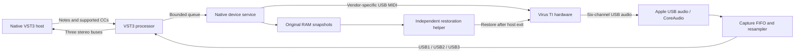

# Virus TI Rework

**Native Apple silicon AU and VST3 integration for the Access Virus TI hardware synthesizer.**

An independent, open-source community project by **Give Me a Signal** to keep owned Virus TI hardware useful on modern Macs. The hardware makes the sound; this plug-in brings its MIDI control, USB audio returns, patch browsing and project recall into a native DAW.

**Status: downloadable beta in preparation; contributions and hardware test reports are welcome.** Working hardware playback and Bitwig project recall have been demonstrated on one TI Desktop. This is not yet a broadly tested, signed and notarized consumer release, nor a drop-in replacement for every Virus Control feature. New project code is MIT licensed. Dark and Polar are self-contained. The optional Original Access appearance is imported locally by the owner; Access resources are not included in downloads.


[Setup](#setup) · [AI-assisted setup](#ai-assisted-setup-for-non-technical-users) · [What works](#what-works) · [How-it-works](#how-it-works) · [Engineering history](#how-we-built-it) · [Screenshots](#interface-gallery) · [Limitations](#known-limitations) · [Help test](#help-test-on-more-macs-and-synths) · [Contribute](CONTRIBUTING.md) · [Release packaging](#packaging-and-binary-releases)

## What works

| Area | Implemented and tested scope |
| --- | --- |
| Native plug-in | arm64 VST3 processor/controller, AUv2 wrapper and Cocoa editor; three stereo output buses and sixteen-channel MIDI input |
| Real hardware audio | Capture through Apple's existing USB audio/CoreAudio support; six device channels mapped to USB1, USB2 and USB3 |
| Host sample rates | TI capture stays at 48 kHz; a 64-tap windowed-sinc resampler and FIFO drift correction adapt to the DAW |
| MIDI and parts | Vendor-specific TI USB MIDI interface, note delivery, supported CC controls, sixteen-part selection and routing |
| Patch browser | Hardware edit buffers and user-imported MIDI/SysEx files; search, categories, two panes and selected-part recall |
| Project recall | Versioned state contains sixteen RAM patches, RAM multi, routing and 2,672 mapped parameter values; connected projects reconnect when realtime processing starts |
| Recovery | Original RAM snapshots before changes; verified manual Disconnect; independent recovery helper after plug-in/DAW exit or host crash |
| Editor | Self-contained Modern Dark and Polar vector appearances plus optional imported original artwork, 100–200% scaling, dynamic graphs and host parameter gestures |
| Metering | Separate note-velocity activity and CC7 volume per part; three actual mixed USB capture peak meters |
| Local API | Per-user Unix socket and Python control tool; no network listener; hardware connection is explicit except restored connected projects |

The vendor-specific MIDI path is reconstructed in user space. **We do not load the old Intel vendor plug-in, install the old kernel extension, or flash the synth.** Stored-bank writes and firmware commands are outside the hardware command allowlist.

## Setup

### Download the beta

Get the latest **macOS arm64 beta ZIP** from [GitHub Releases](https://github.com/Give-me-a-signal/virus-ti-rework/releases).
It contains **Virus TI Rework Setup.app**, **Virus TI Rework.vst3** and **Virus TI Rework.component**.

1. Unzip the download and quit your DAW.
2. Open **Virus TI Rework Setup.app**, select VST3 and/or Audio Unit, and click **Install / Update**.
3. Restart your DAW and rescan plug-ins. Load **Virus TI Rework** on an instrument track.

No Access installer, build tools or Terminal commands are required for normal operation.
**Dark is the default**; Polar is available from the editor. The complete page workflow is present, with
unfinished hardware controls dimmed and disabled. Factory sounds are not bundled: use your hardware's
current sounds or import your own `.mid`/`.syx` patches from the browser bank menu.

These are **ad-hoc signed, unnotarized beta builds**. macOS may block downloaded software. Use the
per-app approval offered under **System Settings → Privacy & Security** where available; do not disable
Gatekeeper or SIP. Report installation blocks with your macOS version. See the ZIP's `INSTALL.txt`.

### Manual installation

Copy the `.vst3` into `~/Library/Audio/Plug-Ins/VST3/` and the `.component` into
`~/Library/Audio/Plug-Ins/Components/` using Finder's **Go → Go to Folder**. Create a missing folder if necessary.
The AU works independently; a separate VST3 installation is optional. Move **Virus TI Rework Development.vst3**
out of the scan folder before manually installing its replacement. Setup handles that backup automatically.

Setup installs for the current user, preserves previous versions in
`~/Library/Application Support/VirusTIRework/PluginBackups/`, and offers uninstall without deleting your sounds,
optional appearance resources or recovery evidence.

### Requirements and verified scope

Apple Silicon Mac, macOS 12 deployment target, an AUv2 or arm64 VST3 host, and physical Virus TI hardware.
A deployment target does not establish compatibility with every OS or host. TI Desktop is the initial hardware
validation target; TI2/Snow remain unverified. AU validator results and test-host checks do not establish
Logic/GarageBand compatibility: real host reports are tracked separately. See [compatibility](docs/COMPATIBILITY.md).

### Optional Original Access appearance

Choose **Import Original Access Appearance…** in Setup, or **Import Original…** from the editor's appearance
selector. Select your own **Virus TI Software Suite 5.1.7.00.pkg**. After import, choose **Original Access**.
Dark and Polar continue to work if import is cancelled, rejected or unavailable. Imported resources are stored
outside the plug-in bundles and shared by AU/VST3.

[Download the original installer from Access](https://www.virus.info/download/585), sign into your Access account,
and choose **Virus TI Installer 5.1.7.00 for macOS** under **macOS 10.7–10.14** if redirected to the
[downloads page](https://www.virus.info/start). [Access registration](https://www.virus.info/signup) is available
for owners who need an account. The old OS label describes the original software, not this plug-in's requirements.
**Do not run the original installer.** Our importer checks SHA-256
`3ebcfef395a6c5f1ef2162404228f1fbe571371f7389836f13c55c8a7636ce1d` and extracts appearance resources only.
Original Access resources retain their own terms and are not included in releases.

### First hardware session

Start the TI in Single mode, preserve important sounds using your normal backup method, and use a disposable
DAW project. Press **Connect TI**, wait for snapshots/initialization, then send notes on MIDI channel 1 for Part 1.
Parts 2–16 use channels 2–16; enable the extra stereo output buses for USB2/USB3. Keep your normal DAW output interface.
Only one instance across both formats may own the device.

Save while connected to capture hardware sounds/routing. Reopening a connected project requests recall when
realtime processing starts. Use **Disconnect** to restore original RAM. Keep the synth powered and connected
until restoration completes after disconnect or host exit. Firmware updates, stored-bank writes and offline
hardware rendering are unsupported. Follow the [staged hardware guide](docs/HARDWARE_TESTING.md).

### Building from source / AI-assisted setup

Developers can run `bash tools/build_beta.sh` after installing Apple Command Line Tools, CMake 3.25+, Ninja,
Git and Python 3. This builds AU/VST3 and Setup without an Access package, runs tests and the VST3 validator,
and creates an audited ZIP in `dist/`. The build fetches pinned Steinberg and Apple SDK revisions.

For help from an AI coding agent, copy:

```text
Help me install and test Virus TI Rework from
https://github.com/Give-me-a-signal/virus-ti-rework .
Read the README and docs/HARDWARE_TESTING.md. Prefer the prebuilt GitHub beta
and graphical setup app; no Access installer is required for Dark or Polar.
Check my Apple chip, macOS, DAW and exact Virus model/firmware. Do not disable
macOS security, update firmware or write stored banks. Use a disposable DAW
project and follow the untested-model restrictions. Record pass/fail/not-tested
for installation, scan, playback, routing, recall and restoration. Let me
review a compatibility report before posting it. If building is necessary,
use tools/build_beta.sh; explain missing developer prerequisites first.
```

## How it works



### Audio transport and driver work

Early work examined the original installer, kernel driver, shared libraries and MIDI driver to recover descriptors, packet layouts, initialization and clock behavior. We implemented bounded PCM conversion, asynchronous request lifecycles, descriptor parsing, rollback/drain behavior and clock-domain experiments as separate native modules.

The connected-device work established a simpler production route: reuse **Apple's existing USB audio transport**, then capture through CoreAudio from a native user-space service. Those earlier low-level transport modules remain useful research and test infrastructure; they are not a claim that a new kernel driver ships with this plug-in.

The production path uses a capture FIFO, 64-tap resampling and occupancy-based drift correction to bridge the TI's fixed 48 kHz stream to the host rate. The callback uses bounded queues and lock-free state; hardware operations, file access and snapshots happen on the worker. Missing audio is silenced. The reported buffering is approximately 42.7 ms, not a measured end-to-end latency figure.

Three-return operation required identifying the original **Global USB controller 9** configuration command. Hardware tests showed the third return was otherwise an input-like signal. Selecting the recovered three-return configuration fixed that path; teardown explicitly normalizes back to the standard two-return behavior.

### MIDI, state and recovery

Public MIDI discovery alone did not reproduce the original TI control path. Static analysis identified a separate vendor-specific USB interface and protocol behavior. The new service opens that interface and sends a restricted set of note, supported CC, RAM-patch, request, routing and mode messages. MIDI reaches the hardware on the worker thread; sample offsets in the VST3 bridge do not imply sample-accurate USB scheduling.

Project state stores real hardware patches, rather than merely the positions of visible knobs. Every dump is bounded and checksum-checked. Bitwig testing exposed two practical defects: overly slow duplicate reads during Save, and host state caching after API-driven edits. Serial single reads and explicit controller dirty notifications resolved the tested save/reopen path.

DAW shutdown exposed another issue: a plug-in cannot rely on being allowed to spend approximately 23 seconds restoring hardware inside termination callbacks. A separate signed helper now retains the original snapshots and exclusive device lease before changes begin. A dedicated local pipe signals normal completion or host disappearance. The helper validates device identity, restores RAM, verifies readbacks and records the outcome even when the host exits abruptly.

### Editor reconstruction

The initial reconstruction used the original XML for the 907×513 layout, control bindings, conditions and value lists. The original PNGs supplied the optional familiar appearance. REA/Ghidra analysis informed waveform display tables, graph geometry and envelope/filter behavior. A new native Cocoa view implements the interaction and VST3 bindings; it does not execute the old editor.

The resource-independent beta uses project-authored control layouts and illustrative graphs for Dark/Polar. Optional original appearance data is parsed locally at runtime. Earlier work drew modern vector controls using the recovered structural layout. Work included dynamic oscillator/filter/envelope graphics, popup semantics, patch-bank parsing, keyboard interaction and scaling. A UI sweep corrected PNG-DPI scaling that displaced oscillator controls, and menu resizing/text layout that stretched arrows or clipped values.

This is a documented reverse-engineering reconstruction, not recovered vendor source and not a clean-room claim. Graphs visualize editor parameters; they are not a software model of the TI's audio engine.

## How we built it

| Stage | Work and outcome |
| --- | --- |
| Inventory | Expanded the owner-supplied 5.1.7.00 package, hashed artifacts, catalogued architecture/framework dependencies and retained originals unchanged. |
| Static analysis | Used the REA skill/MCP and Ghidra to trace the legacy kernel, MIDI, common engine and editor paths; kept evidence IDs and decompilation snapshots locally. |
| Offline foundations | Built and tested descriptor, PCM, queue, MIDI, session and clock modules before relying on connected hardware. |
| Native VST3 | Added arm64 processor/controller, sixteen-part parameters, state validation, three stereo buses and a native editor; exercised the official validator. |
| UI and browser | Reconstructed the original layout, added graph interaction, verified 7,164 patches, corrected layout defects and added Dark/Polar appearances. |
| Real TI audio | Verified vendor-specific MIDI and USB audio, then integrated CoreAudio capture and resampling directly into the plug-in's service. |
| Multi-part validation | Auditioned all sixteen parts, verified sound/routing recall, repaired USB3 initialization and checked 44.1/48/96 kHz host rates. |
| DAW validation | Demonstrated playback in Live; verified native Bitwig project save/reopen, automatic reconnection and all sixteen hardware sounds. |
| Exit recovery | Reproduced the quit-time RAM restoration failure, implemented the independent helper, and tested graceful exit, abrupt termination and normal Bitwig quit. |
| Reproducible builds | Separated owner-supplied resources, added reproducible local setup/packaging, MIT licensing, fresh UI gallery and source-only checks. |

Firmware/wavetable decoding and emulator experiments were a parallel research track. They helped offline investigation but are **not required to play the physical TI**, are not a firmware update feature, and the emulator/runtime sources and binaries are not bundled in this hardware repository.

## Validation and scope

| Check | Recorded result |
| --- | --- |
| Current source packaging build | Six project CTest suites passed; official VST3 validator 47/47; arm64 bundle and restoration helper signatures verified |
| 48 kHz / 256 hardware matrix | Sixteen-part routing/recall, 48 isolated auditions, simultaneous 48-note chord and two reconnects passed |
| Host rate adaptation | Physical three-return checks at 44.1 kHz / 64 and 96 kHz / 512 passed; device remained at 48 kHz |
| Bitwig Studio 5.2.7 | Native save/reopen at 44.1 kHz / 256, 32 isolated auditions, sixteen sounds/multi and all 2,672 saved parameter tuples matched |
| Hardware capture counters | Recorded matrix/Bitwig windows had zero capture errors and FIFO overruns/underruns |
| Exit recovery | Graceful API-host exit, SIGKILL of the test host and normal Bitwig quit restored and verified original RAM; manual Disconnect also passed |
| User testing | Further Bitwig use reported by the owner on 14 October 2026; not presented as a new automated hardware matrix |

See [hardware matrix](docs/hardware-matrix-2026-10-12.md), [Bitwig validation](docs/bitwig-validation-2026-10-12.md), [quit restoration](docs/quit-restoration-2026-10-12.md) and [repository verification](docs/repository-verification.json). Historical notes reference raw evidence under `analysis/`; those captures, personal projects, dumps and proprietary analysis artifacts are deliberately not tracked. Reports distinguish earlier failed runs from later fixes. Earlier sanitizer results apply to their tested revisions, not every later hardware service change.

## Help test on more Macs and synths

You do not need to write code to contribute. A careful report of what works—or fails—on a different setup is one of the most useful contributions you can make.

We need coverage across **Apple silicon chip generations and variants**, **macOS releases and point updates**, **Virus TI models/firmware**, and **native VST3 hosts**. Report your exact chip (including Pro/Max/Ultra where applicable), macOS version/build, DAW version, USB connection path and plug-in commit. A result on one combination does not establish support for another. TI2 and Snow need separate compatibility investigation; the current sixteen-part Desktop path must not be assumed suitable for them.

Start with the [hardware testing guide](docs/HARDWARE_TESTING.md). It separates build/scan checks, device discovery, playback, USB returns, project recall and restoration, so a partial test can still be useful. Use a disposable DAW project and report each stage as **pass**, **fail** or **not tested**. Testing does not require updating firmware, writing stored banks, weakening macOS security or deliberately crashing your DAW.

- [Submit a hardware / macOS compatibility report](https://github.com/Give-me-a-signal/virus-ti-rework/issues/new?template=hardware-test.yml), including successful tests.
- [Report a reproducible bug](https://github.com/Give-me-a-signal/virus-ti-rework/issues/new?template=bug-report.yml).
- Check the [compatibility matrix](docs/COMPATIBILITY.md) before interpreting a report as supported hardware.
- Improve documentation, accessibility, translations or code through a [pull request](CONTRIBUTING.md).

All proposed repository changes go through a branch and PR. The review policy requires a passing `offline-core` check, an up-to-date branch, resolved review conversations and independent maintainer approval. GitHub enforcement and the maintainer activation procedure are recorded in [repository governance](docs/MAINTAINING.md); a policy file alone cannot prevent direct pushes.

## Known limitations

- Development quality and limited hardware/host coverage. No claim that every Virus variant or modern Mac works.
- AUv2 and VST3 beta. No AAX/VST2 release and no automatic migration of old Virus Control project chunks or plug-in identities.
- MIDI scheduling is immediate on the control worker, not sample accurate. Transport/clock synchronization and measured latency compensation need more work.
- Pitch bend, pressure, program changes, complete parameter synchronization and some encodings remain unfinished. 2,672 catalog parameters do not mean 2,672 verified hardware controls.
- Local-only algorithm selectors are not hardware-sent or persisted as full synth state. Some UI surfaces are reconstructed placeholders, including the user arp pattern editor and remote templates.
- Patch-name editing, bank saving, locks, complete accessibility and exact legacy mouse/rasterization parity remain incomplete.
- Physical unplug recovery and exhaustive click/glitch testing remain incomplete. Bitwig's warning about a parameter advertised both for automation and MIDI remains unresolved.
- No offline hardware rendering, firmware flashing or stored-bank writes. The optional emulator research is separate from this release.

## Interface gallery

Fresh **14 October 2026** captures from the real native Cocoa editor render path: twelve pages in each appearance, 36 images total. These are reproducible offscreen view captures, not design mockups or screenshots of a connected DAW session. Test patch names and meter values are deliberate fixtures; they do not imply live hardware activity. Native footer controls are not included in these offscreen captures. Remote and Preferences show the currently reconstructed surfaces, not a claim that all original features work.

<details>
<summary>Modern Dark — all twelve views</summary>

### Easy


### Patch browser


### Oscillators


### Filters and envelopes


### LFOs


### Modulation matrix


### Arpeggiator


### Effects 1


### Effects 2


### Common


### Remote (incomplete)


### Preferences / utility (incomplete)


</details>

<details>
<summary>Modern Polar — all twelve views</summary>

### Easy


### Patch browser


### Oscillators


### Filters and envelopes


### LFOs


### Modulation matrix


### Arpeggiator


### Effects 1


### Effects 2


### Common


### Remote (incomplete)


### Preferences / utility (incomplete)


</details>

<details>
<summary>Original Access artwork — all twelve views</summary>

### Easy


### Patch browser


### Oscillators


### Filters and envelopes


### LFOs


### Modulation matrix


### Arpeggiator


### Effects 1


### Effects 2


### Common


### Remote (incomplete)


### Preferences / utility (incomplete)


</details>

Regenerate the gallery after building with:

```sh
/usr/bin/python3 tools/capture_gallery.py native/vst3/build-package
```

## Packaging and binary releases

`tools/build_beta.sh` builds the resource-independent AU/VST3 and graphical setup app, runs the offline
suites and VST3 validator, and produces a checksum-indexed ZIP. The macOS CI additionally runs `auval`.
Version tags on reviewed `main` publish beta prereleases only after CI passes. See
[binary architecture](docs/BINARY_ARCHITECTURE.md) and [beta release notes](docs/BETA_RELEASE.md).
Developer ID signing and notarization remain future distribution work.
